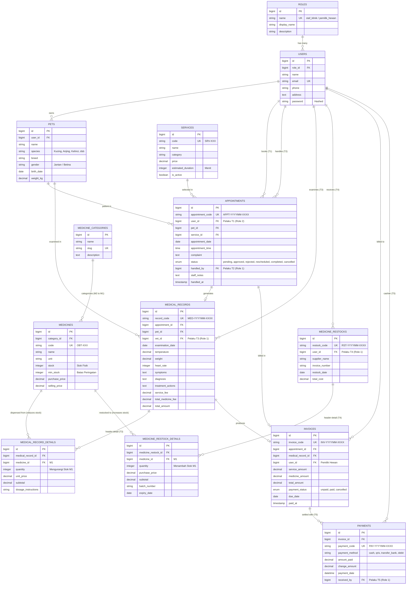

# PawCare Clinic - Sistem Informasi Manajemen Klinik Hewan

> **Tugas Project UAS Mata Kuliah Pengembangan Perangkat Lunak Web (Framework) (Praktikum)**  
> **Framework:** Laravel 12 &bull; **Database:** PostgreSQL 17 &bull; **Styling:** Tailwind CSS & FontAwesome  
> **Arsitektur:** Role-Based Access Control (RBAC), Eloquent ORM, Header-Detail DB::transaction(), Laravel Query Builder

---

## 1. Deskripsi Aplikasi
**PawCare Clinic** adalah aplikasi web berbasis framework Laravel dan database PostgreSQL yang dirancang untuk mengelola seluruh siklus operasional pada klinik dan rumah sakit hewan. Sistem ini mengintegrasikan interaksi antara **Pemilik Hewan (Role 2)** dan **Dokter/Staf Klinik (Role 1)**, serta menyediakan **Katalog Layanan Publik (M3)** yang dapat diakses secara terbuka oleh pengunjung umum (**Guest**).

Aplikasi ini mencakup:
- **Autentikasi & RBAC Server-Side:** Guest (publik), Role 2 (`pemilik_hewan`), dan Role 1 (`staf_klinik`) dengan proteksi middleware di sisi server (menghasilkan HTTP 403 atau pengalihan ke halaman login).
- **3 Data Master Terintegrasi (CRUD Lengkap):** Obat & Perlengkapan Medis (M1), Kategori Obat (M2, berelasi hasMany ke M1), dan Layanan Klinik (M3), serta Data Master Pasien Hewan Peliharaan (*Pets*).
- **5 Transaksi Bisnis Berbeda:**
  1. **T1:** Pengajuan Janji Temu Kunjungan oleh Pemilik Hewan (Role 2).
  2. **T2:** Persetujuan / Penolakan / Reschedule Kunjungan oleh Staf Klinik (Role 1) dengan alur status dua role.
  3. **T3:** Pencatatan Rekam Medis & Peresepan Obat (Header-Detail), disimpan dalam `DB::transaction()` dan otomatis memotong stok obat M1, serta menerbitkan invoice tagihan.
  4. **T4:** Pengadaan & Restock Obat Masuk oleh Staf Klinik (Role 1) berbentuk Header-Detail yang menambah stok obat M1 dalam `DB::transaction()`.
  5. **T5:** Pembayaran Tagihan Kasir dan Halaman Laporan Rekapitulasi menggunakan **Laravel Query Builder** (`join`, `groupBy`, serta fungsi agregat `sum` dan `count`).

---

## 2. Pembagian Peran Anggota Kelompok (Lampiran B)

Sesuai ketentuan template pembagian peran pada dokumen UAS (Kelompok 3-4 Anggota):

| Nama Mahasiswa | NIM | Peran Utama | Tanggung Jawab Master & Transaksi | Bagian yang Dikerjakan |
|---|---|---|---|---|
| **Helga Dianova Ardhani (Ketua)** | 230101001 | Lead Developer & Backend Auth | **M1 (Obat)**<br>**T1 (Pengajuan)**, **T2 (Persetujuan)** | Pengelolaan Git repository, struktur branch, autentikasi login/register/logout, skema RBAC (tabel `roles`, middleware `RoleMiddleware`), seeder akun, Resource Controller Obat (M1), serta alur status dua role janji temu (T1 & T2). |
| **Anggota 2** | 230101002 | UI/UX & Transaction Engineer | **M2 (Kategori Obat)**<br>**T3 (Rekam Medis)**, **T4 (Restock)** | Layout terpusat Blade (`app.blade.php`), halaman katalog Guest, dashboard Role 1 & Role 2, Resource Controller Kategori Obat (M2), implementasi Header-Detail `DB::transaction()` rekam medis (T3) pemotong stok obat, serta form restock penambah stok obat (T4). |
| **Anggota 3** | 230101003 | Database & QA Engineer | **M3 (Layanan)**<br>**T5 (Pembayaran & Laporan)** | Resource Controller Layanan Klinik (M3), perancangan ERD database PostgreSQL, pengujian otomatis PHPUnit Feature Tests, implementasi Query Builder untuk laporan rekap pendapatan & obat (T5), modul Docker containerization, serta dokumentasi README. |

---

## 3. Matriks Hak Akses / RBAC (Lampiran A)

Keterangan:
- **C:** Create (Tambah)
- **R:** Read (Lihat / Tampil)
- **U:** Update (Ubah)
- **D:** Delete (Hapus)
- **-:** Tidak Memiliki Akses (Dicegah server via middleware menghasilkan HTTP 403 atau redirect login)

| Fitur / Modul | Guest (Publik) | Role 2 (Pemilik Hewan) | Role 1 (Dokter & Staf Klinik) |
|---|:---:|:---:|:---:|
| **Katalog Layanan Publik (M3)** | **R** | **R** | **R** |
| **Registrasi Akun Baru** | **C** | - | - |
| **Login / Logout Akun** | **C** | **C** | **C** |
| **Dashboard Sistem** | - | **R** (Dashboard Klien) | **R** (Dashboard Staf) |
| **Master M1: Obat & Medis (`medicines`)** | - | - | **C, R, U, D** |
| **Master M2: Kategori Obat (`medicine_categories`)** | - | - | **C, R, U, D** |
| **Master M3: Layanan Klinik (`services`)** | **R** | **R** | **C, R, U, D** |
| **Master Pasien Hewan (`pets`)** | - | **C, R, U, D** *(Hewan Miliknya)* | **C, R, U, D** *(Seluruh Pasien)* |
| **T1: Pengajuan Kunjungan (`appointments`)** | - | **C, R** *(Miliknya)* | **R** |
| **T2: Persetujuan / Tolak / Reschedule** | - | **R** *(Miliknya)*, **U** *(Batal)* | **U** *(Approve, Reject, Reschedule)* |
| **T3: Rekam Medis Header-Detail (`medical_records`)** | - | **R** *(Hewan Miliknya)* | **C, R** *(Potong Stok M1 & Terbit Invoice)* |
| **T4: Restock Obat Header-Detail (`medicine_restocks`)** | - | - | **C, R** *(Tambah Stok M1)* |
| **T5: Tagihan & Pembayaran Kasir (`invoices`, `payments`)** | - | **R** *(Miliknya)* | **R, C** *(Proses Pelunasan Tagihan)* |
| **T5: Laporan Rekapitulasi (Query Builder)** | - | - | **R** *(Rekap Pendapatan, Obat & Layanan)* |

---

## 4. Entity Relationship Diagram (ERD)

Struktur basis data PostgreSQL dirancang dengan relasi foreign key yang ketat dan pencegahan penghapusan referensial.



---

## 5. Rincian Data Master & 5 Transaksi

### 5.1 Tiga Data Master
1. **M1: Obat & Perlengkapan Medis (`medicines`)**
   - Resource Controller: `MedicineController`.
   - Terhubung dengan relasi `belongsTo` ke Kategori Obat (`medicine_categories`).
   - Dilengkapi validasi form lengkap, pencarian nama/kode, filter kategori, filter stok menipis/habis, serta paginasi.
   - **Pencegahan Hapus:** Sistem memvalidasi apakah obat telah tercatat di `medical_record_details` atau `medicine_restock_details`. Jika sudah pernah dipakai, penghapusan ditolak secara server-side dan memunculkan pesan error yang jelas.
2. **M2: Kategori Obat (`medicine_categories`)**
   - Resource Controller: `MedicineCategoryController`.
   - Terhubung dengan relasi `hasMany` ke data obat (`medicines`).
   - **Pencegahan Hapus:** Jika kategori masih memuat data obat, tombol hapus memicu pengecekan server-side yang menolak penghapusan.
3. **M3: Layanan Klinik (`services`)**
   - Resource Controller: `ServiceController`.
   - Dapat diakses secara terbuka oleh **Guest** pada halaman muka / katalog publik tanpa harus login.
   - **Pencegahan Hapus:** Tidak dapat dihapus jika sudah digunakan dalam janji temu/kunjungan klinik (`appointments`).
4. **Data Master Pendukung: Hewan Peliharaan (`pets`)**
   - Resource Controller: `PetController`.
   - Pemilik Hewan (Role 2) hanya dapat melihat dan mengelola hewan miliknya sendiri. Staf Klinik (Role 1) dapat melihat semua pasien hewan klinik.

---

### 5.2 Lima Transaksi
1. **T1: Pengajuan Kunjungan / Janji Temu (`appointments`)**
   - **Pelaku:** Pemilik Hewan (Role 2).
   - **Proses:** Memilih pasien hewan miliknya, layanan yang diinginkan (M3), tanggal/jam kedatangan, dan keluhan fisik hewan. Status awal tersimpan sebagai `pending` dengan kode unik `APPT-YYYYMM-XXXX`.
2. **T2: Persetujuan / Penolakan / Reschedule Kunjungan**
   - **Pelaku:** Staf / Dokter Klinik (Role 1).
   - **Alur Status Dua Role:** Staf klinik meninjau antrean pengajuan Role 2. Staf dapat:
     - Menyetujui kunjungan (`approved`) disertai instruksi persiapan.
     - Menjadwalkan ulang (`rescheduled`) dengan menentukan tanggal dan jam baru jika kuota penuh.
     - Menolak kunjungan (`rejected`) dengan alasan penolakan yang wajib diisi.
     - Mencatat pelaku staf (`handled_by`) dan waktu kejadian (`handled_at`).
3. **T3: Pencatatan Rekam Medis & Resep Obat (Header-Detail & Pengurangan Stok)**
   - **Pelaku:** Dokter Hewan (Role 1).
   - **Bentuk:** Dokumen Header-Detail (`medical_records` & `medical_record_details`).
   - **Konsistensi Data:** Seluruh proses dibungkus dalam `DB::transaction()`.
   - **Efek Terhadap Data Lain:**
     - Memvalidasi stok fisik obat M1. Jika stok tidak cukup, transaksi langsung dibatalkan (rollback otomatis) dengan pesan validasi yang jelas.
     - Mengurangi stok fisik obat M1 sejumlah yang diresepkan (`$medicine->decrement('stock', $qty)`).
     - Mengubah status janji temu menjadi `completed`.
     - Otomatis menerbitkan dokumen Tagihan / Invoice kunjungan (T5) dengan status `unpaid`.
4. **T4: Pengadaan & Restock Obat Masuk (Header-Detail & Penambahan Stok)**
   - **Pelaku:** Staf Gudang / Farmasi (Role 1).
   - **Bentuk:** Dokumen Header-Detail (`medicine_restocks` & `medicine_restock_details`).
   - **Konsistensi Data:** Dibungkus dalam `DB::transaction()`.
   - **Efek Terhadap Data Lain:**
     - Menambah stok fisik obat M1 (`$medicine->increment('stock', $qty)`).
     - Memperbarui harga beli obat jika terjadi penyesuaian harga supplier.
     - Mencatat nama distributor, nomor faktur, nomor batch, dan tanggal kedaluwarsa.
5. **T5: Pembayaran Tagihan & Laporan Rekapitulasi Query Builder**
   - **Pelaku:** Kasir / Staf Klinik (Role 1).
   - **Pembayaran Kasir:** Menerima pembayaran (Tunai, QRIS, Transfer Bank, Debit), menghitung kembalian uang, dan memperbarui status invoice menjadi `paid`.
   - **Laporan Rekapitulasi Query Builder:**
     Menggunakan `DB::table(...)` dengan relasi `join`, `groupBy`, dan fungsi agregat:
     - **Rekap Pendapatan Harian:** `invoices` join `users`, group by `DATE(paid_at)`, agregat `SUM(total_amount)`, `SUM(service_amount)`, `SUM(medicine_amount)`, `COUNT(id)`.
     - **Rekap Pemakaian Obat Pasien:** `medical_record_details` join `medicines` join `medicine_categories`, group by atribut obat, agregat `SUM(quantity)` dan `SUM(subtotal)`.
     - **Rekap Utilisasi Layanan:** `appointments` join `services`, group by layanan, agregat `COUNT(appointments.id)` serta hitungan status `completed`, `approved`, dan `rejected`.
     - Dilengkapi filter rentang tanggal (`start_date` s.d. `end_date`).

---

## 6. Daftar Akun Pengujian (Seeder)

Aplikasi telah dilengkapi seeder akun dengan password yang di-hash menggunakan algoritma **Bcrypt**:

| Peran (Role) | Nama Pengguna | Alamat Email | Kata Sandi (Password) | Hak Akses Utama |
|---|---|---|---|---|
| **Role 1 (`staf_klinik`)** | drh. Sarah Amelia | `drh.sarah@pawcare.com` | `password123` | Akses penuh: CRUD M1, M2, M3, Persetujuan Janji Temu (T2), Input Rekam Medis (T3), Restock Obat (T4), Kasir (T5), dan Laporan Rekapitulasi. |
| **Role 1 (`staf_klinik`)** | Dimas Pratama (Paramedis) | `staf.dimas@pawcare.com` | `password123` | Staf paramedis & kasir klinik. |
| **Role 2 (`pemilik_hewan`)** | Budi Santoso | `budi.santoso@gmail.com` | `password123` | Pemilik hewan Milo & Choco. Mengajukan janji temu (T1), melihat rekam medis miliknya, dan melihat tagihan. |
| **Role 2 (`pemilik_hewan`)** | Siti Aminah | `siti.aminah@gmail.com` | `password123` | Pemilik hewan Luna & Snowy. Mengajukan janji temu dan memantau riwayat medis. |
| **Guest** | Pengunjung Umum | *(Tanpa Login)* | *(Tanpa Login)* | Melihat katalog layanan M3, jam operasional klinik, serta login/registrasi akun baru. |

*(Tersedia tombol satu-klik **"Pilih Akun Demo"** pada halaman login untuk kemudahan demonstrasi).*

---

## 7. Cara Instalasi & Menjalankan Aplikasi

### 7.1 Menjalankan Secara Lokal (PHP & PostgreSQL)

#### 1. Persyaratan Sistem
- PHP >= 8.2 dengan ekstensi `pdo_pgsql`, `pgsql`, `mbstring`, `openssl`.
- PostgreSQL Database Server (Port 5432).
- Composer 2.x.

#### 2. Kloning / Buka Direktori Project
```bash
cd /path/ke/uasframework
```

#### 3. Instal Dependensi Composer
```bash
composer install
```

#### 4. Konfigurasi Environment (`.env`)
Salin file `.env.example` ke `.env` (atau edit file `.env`):
```env
APP_NAME="PawCare Clinic"
APP_ENV=local
APP_KEY=base64:HS7f2PG5v4j3qWcu5c7EpMv3qbdNWBHeJK4O9H+rwSI=
APP_DEBUG=true
APP_TIMEZONE="Asia/Jakarta"
APP_URL=http://localhost:8000

DB_CONNECTION=pgsql
DB_HOST=127.0.0.1
DB_PORT=5432
DB_DATABASE=pawcare_clinic
DB_USERNAME=postgres
DB_PASSWORD=12345678

SESSION_DRIVER=file
```

#### 5. Buat Database PostgreSQL
Jalankan di terminal / `psql` (atau melalui pgAdmin):
```sql
CREATE DATABASE pawcare_clinic;
```

#### 6. Jalankan Migration dan Seeder
Perintah ini akan membuat 11 tabel lengkap dan mengisinya dengan data awal realistis:
```bash
php artisan migrate:fresh --seed
```

#### 7. Jalankan Server Pengembangan Laravel
```bash
php artisan serve
```
Akses aplikasi melalui peramban web di: **`http://localhost:8000`**

---

### 7.2 Menjalankan Pengujian Otomatis (Automated Feature Tests)
Aplikasi dilengkapi pengujian fitur otomatis (PHPUnit) yang mencakup otorisasi RBAC (Guest vs Role 2 vs Role 1), validasi form, pencegahan hapus data master, dan pemotongan stok pada transaksi atomik.

Jalankan perintah pengujian:
```bash
php artisan test
```
*Hasil:* 11 tes sukses berjalan (`11 passed`, `27 assertions`).

---

### 7.3 Menjalankan dengan Docker (Nilai Tambah / Opsional)

Proyek ini telah dilengkapi `Dockerfile`, `docker-compose.yml`, dan konfigurasi Nginx:

1. Pastikan Docker Desktop telah terpasang dan aktif.
2. Jalankan perintah:
```bash
docker-compose up -d --build
```
3. Jalankan migrasi dan seeder di dalam container:
```bash
docker-compose exec app php artisan migrate:fresh --seed
```
4. Buka di browser: **`http://localhost:8000`**.

---

## 8. Struktur Direktori Utama
```text
uasframework/
├── app/
│   ├── Http/
│   │   ├── Controllers/
│   │   │   ├── AppointmentController.php      # Transaksi T1 & T2
│   │   │   ├── AuthController.php             # Login, Register, Logout
│   │   │   ├── DashboardController.php        # Dashboard Role 1 & Role 2
│   │   │   ├── InvoiceController.php          # Transaksi T5 (Tagihan)
│   │   │   ├── LandingController.php          # Halaman Publik Katalog M3
│   │   │   ├── MedicalRecordController.php    # Transaksi T3 (DB::transaction & potong stok)
│   │   │   ├── MedicineCategoryController.php # Master M2 (CRUD & Cegah Hapus)
│   │   │   ├── MedicineController.php         # Master M1 (CRUD & Cegah Hapus)
│   │   │   ├── MedicineRestockController.php  # Transaksi T4 (DB::transaction & tambah stok)
│   │   │   ├── PaymentController.php          # Transaksi T5 (Kasir Pelunasan)
│   │   │   ├── PetController.php              # Master Pasien Hewan (Pets)
│   │   │   ├── ReportController.php           # Transaksi T5 (Laporan Query Builder)
│   │   │   └── ServiceController.php          # Master M3 (Katalog Layanan)
│   │   └── Middleware/
│   │       └── RoleMiddleware.php             # Proteksi Server-Side RBAC (HTTP 403)
│   └── Models/
│       ├── Appointment.php
│       ├── Invoice.php
│       ├── MedicalRecord.php
│       ├── MedicalRecordDetail.php
│       ├── Medicine.php
│       ├── MedicineCategory.php
│       ├── MedicineRestock.php
│       ├── MedicineRestockDetail.php
│       ├── Payment.php
│       ├── Pet.php
│       ├── Role.php
│       ├── Service.php
│       └── User.php
├── database/
│   ├── migrations/                            # 11 Skema Tabel Terstruktur
│   └── seeders/
│       └── DatabaseSeeder.php                 # Seeder Akun, M1-M3, Hewan & Transaksi T1-T5
├── resources/
│   └── views/
│       ├── appointments/                      # Tampilan T1 & T2
│       ├── auth/                              # Login & Registrasi Klien
│       ├── dashboard/                         # Dashboard Staf & Pemilik
│       ├── invoices/                          # Faktur Tagihan & Kasir T5
│       ├── layouts/
│       │   └── app.blade.php                  # Layout Terpusat Tailwind CSS
│       ├── medical_records/                   # Form Header-Detail & Rincian T3
│       ├── medicine_categories/               # CRUD M2
│       ├── medicines/                         # CRUD M1
│       ├── medicine_restocks/                 # Form Header-Detail & Rincian T4
│       ├── pets/                              # CRUD Pasien Hewan
│       ├── reports/                           # Tampilan 3 Tab Query Builder T5
│       ├── services/                          # CRUD M3
│       └── landing.blade.php                  # Katalog Publik Guest M3
├── tests/
│   └── Feature/
│       ├── MasterCrudValidationTest.php       # Tes Validasi & Cegah Hapus Master
│       ├── RbacAccessTest.php                 # Tes Hak Akses Guest, Role 1, Role 2 (403)
│       └── TransactionStockTest.php           # Tes Atomisitas & Perubahan Stok Fisik
├── Dockerfile
├── docker-compose.yml
└── README.md
```
